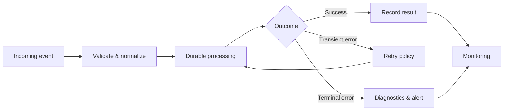

# Lakshay Singh

### Backend Development · Systems Integration · Applied AI

**Developer Apprentice at NEC India** · Building dependable software, APIs, and automation.

---

## About me

I work on **backend systems, enterprise integrations, infrastructure automation, and AI-enabled applications**. My engineering interests are **reliable services, clear APIs, fault recovery, operational monitoring, and practical machine learning**.

- **Currently:** Developer Apprentice at **NEC India**, working on the Delhi Safe City Project
- **Core strengths:** Python, FastAPI, SQL, C#/.NET, integrations, automation
- **Exploring:** LLM applications, retrieval-augmented generation, open-source backend engineering
- **Next milestone:** Meaningful open-source contributions and **GSoC 2027** preparation

## Engineering experience

**NEC India | Developer Apprentice | Delhi Safe City Project**

<table>
<tr>
<td valign="top" width="50%">

**Integration platform & backend services**

- Designed and developed a separate **ERSS integration platform**
- Created an **IIS operations dashboard** and **Windows worker service**
- Worked on **durable incident queuing, retries, idempotency, health checks, and diagnostics**
- Implemented worker leadership and designed active/standby failover

</td>
<td valign="top" width="50%">

**Enterprise integrations**

- Worked with **Genetec Mission Control, WebSDK, CAD**, and related integration workflows
- Built and tested connectivity and service-integration paths
- Focused on monitoring, error handling, and operational visibility

</td>
</tr>
<tr>
<td valign="top">

**Face Attendance System**

- Designed and developed a **production-deployed** application
- Face-based check-in/out and liveness verification
- Employee administration, shift/leave workflows, offline synchronization, and reporting

</td>
<td valign="top">

**Infrastructure & camera automation**

- Python-based **network/switch audits**, configuration checks, and structured Excel reporting
- Device connectivity troubleshooting and validation
- Browser-driven camera configuration automation using **Playwright**

</td>
</tr>
</table>

> **Project maturity:** The ERSS development dashboard, worker service, health endpoints and worker leadership are operational. Live incident processing and end-to-end failover validation remain pending; this is **not** described as a completed production rollout.

<b>Visual: how I think about reliable integrations</b>

*Conceptual engineering pattern — not an internal system diagram.*

## Technical toolkit

**Languages & backend**

`REST APIs` · `Pydantic` · `Uvicorn` · `Windows Services` · `SignalR`

**Databases & data**

&nbsp;&nbsp;
&nbsp;&nbsp;
&nbsp;&nbsp;

**Machine learning & LLM development**

`Hugging Face Transformers` · `OpenAI API` · `LangChain` · `LangGraph` · `LlamaIndex` · `Sentence Transformers`

**Development & automation tools**

`Playwright` · `PowerShell` · `Excel Reporting` · `Integration Testing`

## Selected public repositories

<table>
<tr>
<td width="50%" valign="top">

### [AI-Powered Invoice Extractor](https://github.com/MrStark65/AI-Powered-Invoice-Extractor)
Document extraction and structured-data workflows.

`Python` `AI` `Document Processing`

</td>
<td width="50%" valign="top">

### [AI Minesweeper](https://github.com/MrStark65/ai-minesweeper)
Reasoning, constraint-solving and game logic.

`Algorithms` `Problem Solving`

</td>
</tr>
<tr>
<td valign="top">

### [Face Emotion Detection](https://github.com/MrStark65/Face-Emotion-Detection)
Computer vision and facial-expression recognition experiments.

`Computer Vision` `ML`

</td>
<td valign="top">

### [Movie Recommendation System](https://github.com/MrStark65/movie_recommended_system)
Recommendations and data-driven prediction experiments.

`Python` `Machine Learning`

</td>
</tr>
</table>

### Other engineering work

`ERSS Operations Dashboard` · `Face Attendance System` · `Network VLAN Auditing` · `SNMP Configuration Automation` · `ANPR Camera Configuration Automation`

*These include workplace projects; source code is not represented as publicly available.*

## Open source · GSoC 2027

Exploring the backend ecosystems of **[PyAirbyte](https://github.com/airbytehq/PyAirbyte)** and **[Meshery](https://github.com/meshery/meshery)** with an emphasis on reproducing bugs, understanding existing architecture, writing focused tests, and contributing maintainable fixes.

[**See my public pull requests →**](https://github.com/pulls?q=is%3Apr+author%3AMrStark65)

Exploration or issue investigation does not imply accepted or merged contributions.

## GitHub activity

<b>Engineering principles</b>

- **Reliability first:** define failure modes, retries, and recovery paths.
- **Make systems observable:** logs, health checks, meaningful error reporting.
- **Automate repeatable work:** reduce manual changes and produce auditable results.
- **Keep learning:** read source, reproduce bugs, test changes, welcome review.

---

**Build carefully. Test edge cases. Keep improving.**

Confidential endpoints, internal network details, credentials, employee data, and proprietary source code are intentionally omitted.

