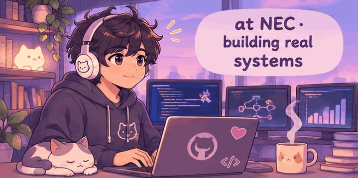
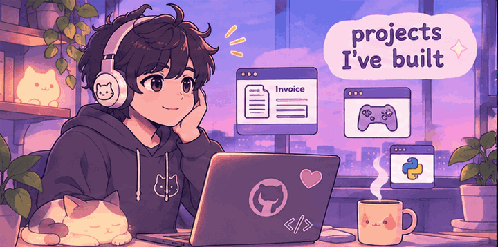
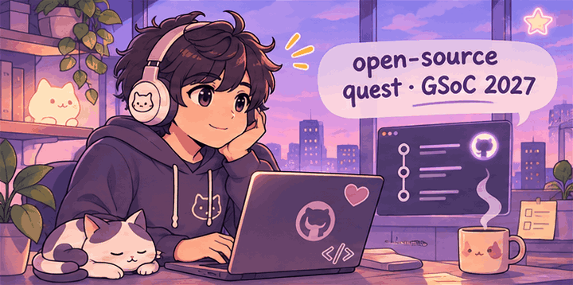

Lakshay Singh · building, debugging, learning
Backend · Integrations · AI · Automation
GitHub · LinkedIn

💼 Work @ NEC India

ERSS & Genetec integrations — Designed a separate integration platform with an operations dashboard, Windows worker service, durable queues, retries, idempotency, monitoring and planned active/standby failover. Development services are operational; live incident processing and end-to-end failover validation are still pending.
Face Attendance System — Designed and developed a production-deployed system for facial check-in/out, liveness checks, employee management, offline sync and attendance reporting.
Other work — Third-party integration, Python network automation, integration testing and troubleshooting.
🛠 What I use
Python · FastAPI · SQL · PostgreSQL · SQL Server · PyTorch · LangGraph · Git
🎮 Projects

Invoice Extractor · AI Minesweeper · Face Emotion Detection
🌱 Open-source journey

Exploring PyAirbyte and Meshery while preparing for GSoC 2027. No unverified merged-contribution claims.
My public PRs
NEC internal IPs, URLs, credentials, and restricted architecture details intentionally omitted.
